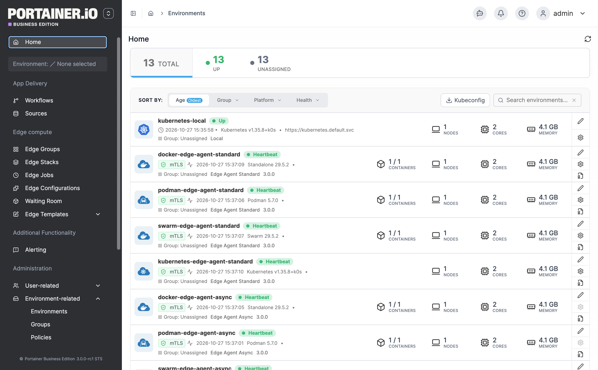

# Add a D2K environment

D2K serves the Docker API from a namespace of a Kubernetes environment, translating Docker API calls into Kubernetes resources. This lets you manage Docker workloads - containers, stacks, volumes, and networks - on a Kubernetes cluster, without installing a second agent or giving up Kubernetes as the underlying platform.


D2K runs in a Kubernetes environment that already has an Edge Agent, running Portainer Agent 3.0.0 or later, connected through a tunnel. Kubernetes environments connected via a Portainer Agent, a local connection, or an Edge Agent in Async mode cannot run D2K.


To add a D2K environment, from the menu select **Environments**, then select **Add environment**. From the environment type list, select **D2K** then click **Start Wizard**.

<figure><figcaption></figcaption></figure>

| Field/Option           | Overview                                                                                                                                                                                                                     |
| ---------------------- | ---------------------------------------------------------------------------------------------------------------------------------------------------------------------------------------------------------------------------- |
| Kubernetes environment | Select the Kubernetes environment to run D2K in. Only eligible environments can be selected - any others are listed with the reason they can't be used.                                                                      |
| Quantity               | Install up to 10 D2K instances at once, each with the same settings.                                                                                                                                                         |
| Name                   | Enter a name for each instance. Each instance runs in its own namespace, `d2k-<name>`, and gets a D2K environment of the same name.                                                                                          |
| Swarm mode             | Enable to have the instances emulate a Docker Swarm manager rather than a standalone Docker engine, so their D2K environments support services, configs, secrets, and Swarm stacks. This can't be changed after the install. |

Group and tags for the new D2K environments can be set from **More settings**.

When ready, click **Install and connect**. Each instance is installed independently, so if one fails the others are still created; any instance that fails is kept in the form so you can try it again.


Deleting a D2K environment removes it from Portainer only - its d2k install and the workloads it manages are left running in the cluster. If the Kubernetes environment a D2K environment depends on is deleted, the D2K environment is marked down and greyed out in the environment list, since Portainer no longer has a way to reach it - its d2k install and workloads are still left in the cluster.


<figure><figcaption></figcaption></figure>

### What's different about a D2K environment

A D2K environment appears in the environment list like any other Docker or Docker Swarm environment, tagged **D2K in namespace d2k-\<name>** (or **D2K Swarm in namespace d2k-\<name>** in Swarm mode). Users with access to it manage its Docker resources the same way as on any other Docker environment, under the same Docker RBAC.

A few things aren't available, since d2k either can't support them yet or they don't apply to a Kubernetes-backed engine:

* Container **kill**, **pause**, and **resume** are not available.
* The **Images** list is read-only - d2k stores no images, since the kubelet pulls them on the cluster's nodes, so pulling, building, removing, pruning, and importing/exporting images aren't available.
* Host details don't show disk usage.
