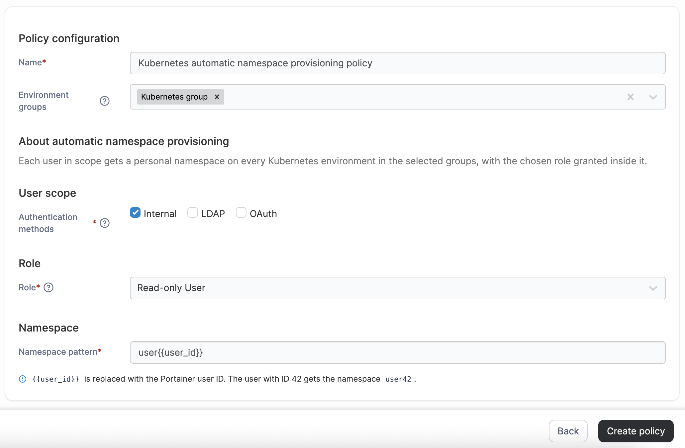

# Create a Kubernetes automatic namespace provisioning policy

Define a policy that automatically provisions a personal Kubernetes namespace for each eligible user, with a namespace-scoped role granted inside it. This removes the need to create namespaces and grant access by hand as users join, change their authentication method, or leave - access is granted and withdrawn automatically as each user's eligibility changes.

To create an automatic namespace provisioning policy, in the menu, under **Environment-related**, select **Policies** then select **Create policy**. From the policy type list, select the **Kubernetes** > **Automatic Namespace Provisioning** section, select **Custom**, then select **Continue** to start configuring the policy.


This policy requires environments running Edge Agent version 3.0.0 or later.


| Field/Option           | Overview                                                                                                                                                                                                                                          |
| ---------------------- | ------------------------------------------------------------------------------------------------------------------------------------------------------------------------------------------------------------------------------------------------- |
| Name                   | Define a name for this policy.                                                                                                                                                                                                                    |
| Environment groups     | 
Select one or more Kubernetes environment groups from the dropdown menu. If the selected group is already included in an existing policy, a warning icon will appear next to the group name.
                                            |
| Authentication methods | Select one or more authentication methods - **Internal**, **LDAP**, or **OAuth**. Only users whose most recent login used one of the selected methods are eligible for a namespace from this policy.                                              |
| Role                   | Select the role granted to each eligible user inside their own namespace. Only namespace-scoped roles that can't be used to list every user's namespace are offered: **Standard User**, **Namespace Operator**, or **Read-Only User**.            |
| Namespace pattern      | Enter a pattern for the namespace each eligible user receives. It must include the placeholder `{{user_id}}`, which is replaced with the user's Portainer ID - for example, `user-{{user_id}}` gives the user with ID 42 the namespace `user-42`. |


Namespaces are generated from each user's stable Portainer ID rather than their username, so renaming a user in your identity provider does not move them to a different namespace.


When you have finished configuring the policy, click **Create policy**. A confirmation screen displays the changes being made and any existing policy that will be replaced. Click **Confirm** to acknowledge the changes and create the policy.


The initial administrator account is never provisioned a namespace by this policy, even if its authentication method matches one of the selected methods - it already has unrestricted access to every environment.


<figure><figcaption></figcaption></figure>
