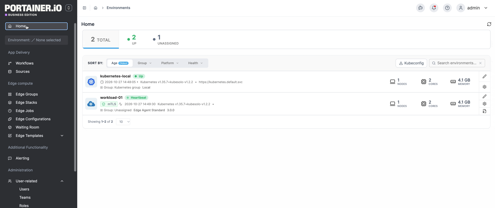
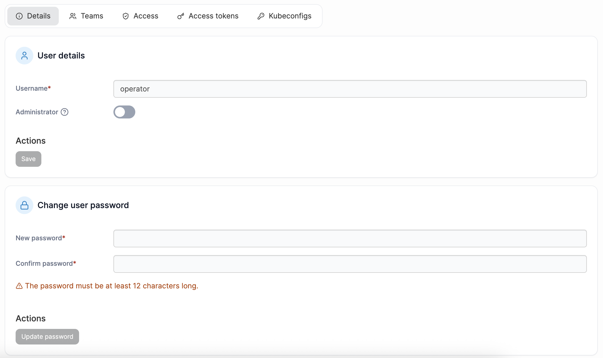
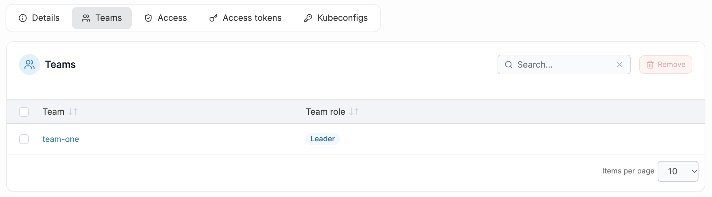
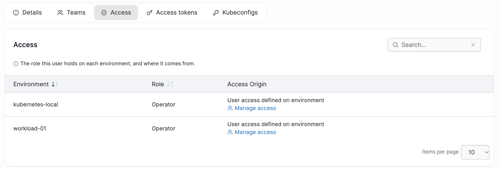
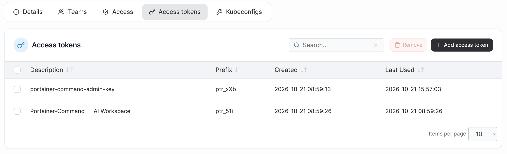
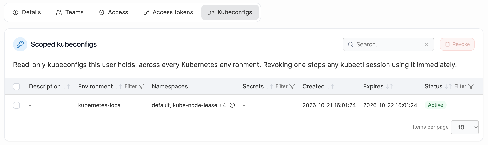

# Manage a user


Only an administrator can open another user's details - a standard user can only open their own.


From the menu expand **User-related** then select **Users**, then click a username to open their details. You can also reach your own user details from **My profile** in the username menu at the top right of any page.

<figure><figcaption></figcaption></figure>

The header shows the user's role, and how many teams, access tokens and kubeconfigs they hold. Select **Refresh** to reload this data, or **Delete** to remove the user - only available to an administrator viewing someone else's entry, and not for the built-in initial admin account.

### Details tab

If you're an administrator, you can edit the **Username** and toggle **Administrator** on or off here, then select **Save**. Renaming a user prompts for confirmation before saving. Viewing your own account without administrator rights shows these read-only instead.

#### Change user password


This section only appears when using internal authentication (or for the built-in admin account, regardless of authentication method), and only once minimum password length requirements have been configured.


Enter a **New password** and **Confirm password**, then select **Update password**.


Changing your own password also requires your **Current password**, and signs you out once it's updated. An administrator resetting another user's password does not need that user's current password, and the administrator's own session is unaffected.


<figure><figcaption></figcaption></figure>

### Teams tab

Lists the teams this user belongs to and their role in each - **Member** or **Leader**. Select a team name to go to its details.

If you're an administrator, select a team and a role from the dropdowns above the table, then select **Add** to add the user to another team. Select one or more rows and use the delete button to remove the user from those teams. You can also add a user to a team from the team's own page.

<figure><figcaption></figcaption></figure>

### Access tab

Shows the effective access this user has across every environment, and which role it comes from - the same information as the Effective access viewer on the Roles page, already filtered to this user.

<figure><figcaption></figcaption></figure>

### Access tokens tab

Lists this user's access tokens. You can only see this tab for yourself, or for a non-administrator - an administrator's access tokens are visible only to that administrator, even to other administrators.

<figure><figcaption></figcaption></figure>

### Kubeconfigs tab

Lists every kubeconfig this user holds, across every Kubernetes environment. Revoking one immediately stops any `kubectl` session using it.

<figure><figcaption></figcaption></figure>
