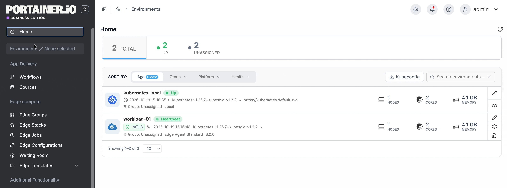
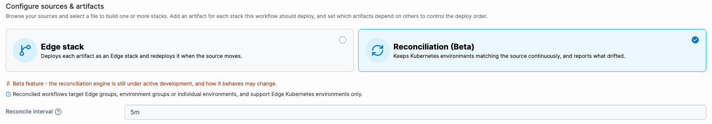
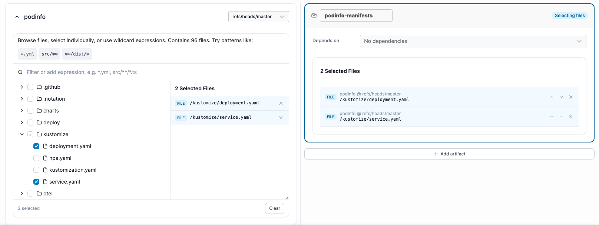
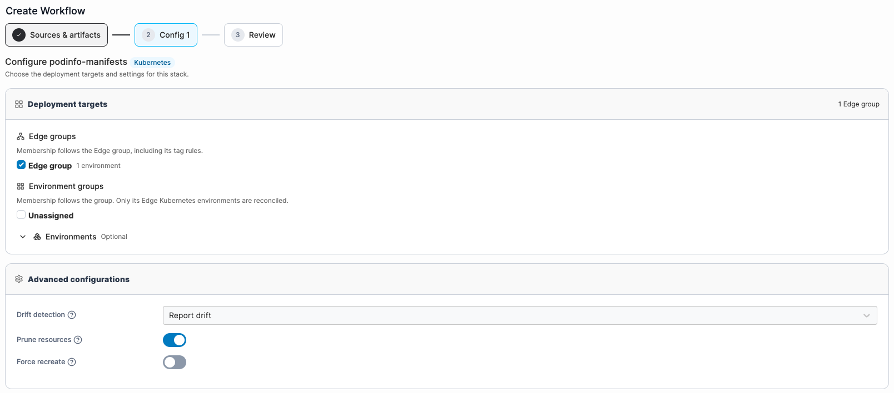

# Add a new workflow


Creating a workflow assumes you have:

* At least one [source](../sources/)
* At least one [edge group](../../edge/groups.md)


To create a new workflow, in the left-hand menu select **Workflows**, then select **Add new** at the top right of the page.

<figure><figcaption></figcaption></figure>



### Configure sources & artifacts

Browse your sources and select files to build one or more stacks. Add an artifact for each stack this workflow should deploy, and set which artifacts depend on others to control the deploy order.



#### Choose an engine

Before adding sources, choose the engine that will keep this workflow's artifacts in step with their source:

| Engine                                | Description                                                                                                            |
| ------------------------------------- | ---------------------------------------------------------------------------------------------------------------------- |
| **Edge stack**                        | Deploys each artifact as an Edge stack and redeploys it when the source moves. Supports Docker and Kubernetes.         |
| **Reconciliation** _(Currently Beta)_ | Continuously keeps Kubernetes environments matching the source, and reports - or corrects - anything that has drifted. |


The reconciliation engine supports **Edge Kubernetes environments only**. It can target Edge groups, environment groups, or individual environments.

If Edge compute features are switched off in Portainer settings, the reconciliation engine is the only option available.



Switching an existing workflow from Edge stack to Reconciliation is a one-way migration. See [Migrate to the reconciliation engine](manage-a-workflow.md#migrate-to-the-reconciliation-engine).


**Reconcile interval** _(reconciliation engine only)_\
How often each environment checks itself against the source, even when the source has not moved. This is what makes drift detectable. Enter a duration such as `5m` or `1h`. Set `0` to turn the periodic check off - artifacts still deploy when their source moves, but nothing re-reads them in between.

<figure><figcaption></figcaption></figure>



#### Add your sources

Select a GitOps [source](../sources/) to pull files from, then pick a branch or tag using the ref selector. Select **Add source** to pull files from additional sources in the same workflow, or select the remove icon on a source's panel to drop it.


With the Edge stack engine, an artifact's files must all come from a single source - selecting files from a different source for the active artifact replaces its current selection. With the Reconciliation engine, a single artifact can combine files from multiple sources and references.




#### Select your files

For the artifact marked **Selecting files**, browse the file tree in each source's panel, or search for a file using a wildcard expression, then select the files that define it. You can also drag a file straight from a source's file tree onto the artifact card you want it in - this assigns the file and makes that artifact the active one, without needing to select it first. Based on the files you select, Portainer automatically detects whether the artifact is a Docker Compose or Kubernetes deployment.


With the Reconciliation engine you can also select whole directories, which Portainer applies the way `kubectl apply -f <directory>` would. If a selected directory contains a `Chart.yaml`, it's detected as a Helm chart automatically - see [Helm chart options](../../../advanced/helm-chart-configuration-options.md) in the next step. Selecting a different chart later replaces the one already configured, which removes its release from every environment and installs the new one in its place.




#### Name and configure your artifacts


With the Edge stack engine, you can select more than one file here regardless of your targets' Edge Agent version. Only an Edge Agent running version 3.0 or later actually deploys every selected file - an older agent ignores everything beyond the entry file and deploys only that one.


Each stack to deploy is configured as its own **artifact** card:

| Field           | Overview                                                                                                                                                                             |
| --------------- | ------------------------------------------------------------------------------------------------------------------------------------------------------------------------------------ |
| Name            | A name for the artifact. This name can't be changed once the workflow is created.                                                                                                    |
| Selecting files | Shows which artifact the file browser above is currently adding files to. Select **Select files here** on another artifact's card, or drag a file onto it, to make it active.        |
| Depends on      | Choose other artifacts in this workflow that must be deployed before this one.                                                                                                       |
| File list       | The files selected for this artifact. Drag to reorder them - for the Edge stack engine, the first file in the list is the entrypoint. Select the X icon next to a file to remove it. |

Select **Add artifact** to deploy more than one stack from this workflow, or the remove icon on an artifact's card to delete it.

<figure><figcaption></figcaption></figure>



Select **Continue** once you've finished configuring your sources and artifacts.



### Configure the workflow



#### Select a deployment target



Select one or more [edge groups](../../edge/groups.md) to deploy this stack to. Each group shows its platform badge (Docker or Kubernetes) and the number of environments it contains. Only groups that match the detected deployment type from the previous step are listed.



The reconciliation engine can target three kinds of target, and any combination of them can be used together:

* **Edge groups** - each environment in the group that is an Edge Kubernetes environment receives the deployment. Groups that contain no Edge Kubernetes environments are shown but disabled.
* **Environment groups** - every environment in the group is included. The group is stored by reference, so environments added to the group later are automatically included.
* **Individual environments** - named environments targeted directly rather than through a group. Use this for one-off inclusions; groups are the better choice for recurring fleets.

The deployment targets card shows a running count of what has been selected across all three kinds.





#### Helm chart options _(reconciliation engine only)_

When a selected path is a directory that contains a `Chart.yaml`, Portainer detects it as a Helm chart and shows additional options:

**Deploy as a Helm chart**\
When on (the default for a detected chart), Portainer renders the chart and applies the result. Turn this off to apply the directory's files as plain Kubernetes manifests instead. This option is only useful for a directory that holds both valid manifests alongside the chart files.

**Override values**\
One or more values files to merge over the chart's own `values.yaml`, applied in the order listed so a later file wins. Files from outside the chart directory can also be selected. The chart's own `values.yaml` is the base and is not listed here.


Use **Search the whole source** to find values files stored outside the chart directory.




#### Select your advanced configurations



**Use namespace(s) from manifest:** When on, Portainer enforces the namespace(s) declared in the manifest file itself, rather than letting the deployment use or be overridden by a default namespace. Only visible when the selected file was detected as a Kubernetes deployment.

**Prune resources:** When enabled, updating this artifact will also delete the resources it previously created that the manifest no longer declares. Turning this off leaves those resources running on the cluster with nothing in Portainer pointing at them.

**Force recreate:** For fields that cannot be changed after a resource is created, enable force recreate to let Portainer delete and recreate resources instead of failing the deployment.

**Drift detection** _(reconciliation engine only)_\
Controls what happens when a resource on the cluster stops matching the source:

* **Report drift** _(default)_ - marks the deployment as Drifted and records which fields changed, but does not make any changes to the cluster. Use this to be alerted to out-of-band changes without having them automatically reverted.
* **Reconcile drift** - on the next reconcile interval, automatically re-applies only the resources that have changed, reverting them to the state the source declares. For Helm releases, this is done without creating a new revision.

**Enable relative path volumes:** Allows the deployment file to reference paths relative to the repository root as bind-mount volumes. When enabled, Portainer clones the repository to the specified filesystem path on the edge device before deploying, making those relative paths valid on the host.

**Always clone git repository:** When on, Portainer always performs a full clone of the repository on every deploy cycle, rather than reusing a previously cloned copy. Ensures the edge device always has the exact current state of the repository but increases deploy time and bandwidth.

**GitOps edge configurations:** Enables per-device configuration using folder or file names that match the Portainer Edge ID of each device. When a deploy runs, Portainer looks for a folder or file in the repository whose name matches the device's Edge ID and applies it as the configuration for that device. The Edge ID is also injected as an environment variable: `PORTAINER_EDGE_ID`. This makes it possible to ship a single workflow that deploys different configuration to different edge devices from one repository.



**Enable relative path volumes:**\
Allows the deployment file to reference paths relative to the repository root as bind-mount volumes. When enabled, Portainer clones the repository to the specified filesystem path on the edge device before deploying, making those relative paths valid on the host.

**GitOps edge configurations:**\
Enables per-device configuration using folder or file names that match the Portainer Edge ID of each device. When a deploy runs, Portainer looks for a folder or file in the repository whose name matches the device's Edge ID and applies it as the configuration for that device. The Edge ID is also injected as an environment variable: `PORTAINER_EDGE_ID`.

This makes it possible to ship a single workflow that deploys different configuration to different edge devices from one repository.


Files named `${PORTAINER_EDGE_ID}.env` or `${PORTAINER_EDGE_GROUP}.env` inside the config folder are automatically loaded for Compose variable interpolation.






#### Add any environment variables

Optionally, add environment variables using one of the following methods:

* Select **Add an environment variable** to add variables individually.
* Select **Load variables from .env file** to import them from a file.
* Switch to advanced mode and paste `key=value` pairs directly into the text box.



#### Specify any registry settings _(Edge stack engine only)_

**Pre-pull images:**\
Pulls the image before deployment starts, useful when image downloads may be slow or unreliable and could otherwise cause the deployment to fail.

**Retry deployment:**\
Lets the edge agent retry deployment if it fails initially. If enabled, choose a retry window: 10 minutes, 1 hour, 1 day, 1 week, or 1 year.

**Use credentials**:\
Lets you provide credentials for a private registry that requires authentication. If enabled, select the registry to use.



#### Select your updates configuration _(Edge stack engine only)_

The **Update strategy** controls how the deployment is rolled out across edge devices when a new version is pushed:

* **All at once:** deploys to all targeted devices simultaneously. Fastest but carries the highest risk if the new version has issues.
* **Parallel edge device(s):** deploys to a subset of devices at a time, waiting between batches. Limits blast radius if something goes wrong mid-rollout.

**Parallel device count:**\
How many edge devices receive the update in each batch. Two sub-options:

* **Fixed:** the same number of devices per batch throughout the rollout.
* **Incremental:** the batch size grows with each round (e.g. 1 → 2 → 4…), useful for a canary-style progressive rollout.

**Timeout:**\
How long Portainer waits for a batch to complete before treating it as failed and applying the failure action.

**Update delay:**\
Waiting period between batches. Gives services time to stabilise before the next group of devices is updated.

**On failure:**\
What Portainer does when a batch fails or times out:

* **Continue:** proceed to the next batch regardless. Use when a partial rollout is acceptable.
* **Pause:** stop the rollout and wait for manual intervention. Failed devices stay on their current version.
* **Rollback:** automatically revert failed devices to the previous working version.

<figure><figcaption></figcaption></figure>



Select **Continue** when you've finished configuring your workflow.



### Name and review your workflow

Name the workflow and confirm everything before it's created.



Select **Create** once you're happy with the configuration. Portainer creates the workflow, the stack, and begins deploying to the selected edge groups. All resources are created together in one operation. The new workflow will appear in the Workflows table.
