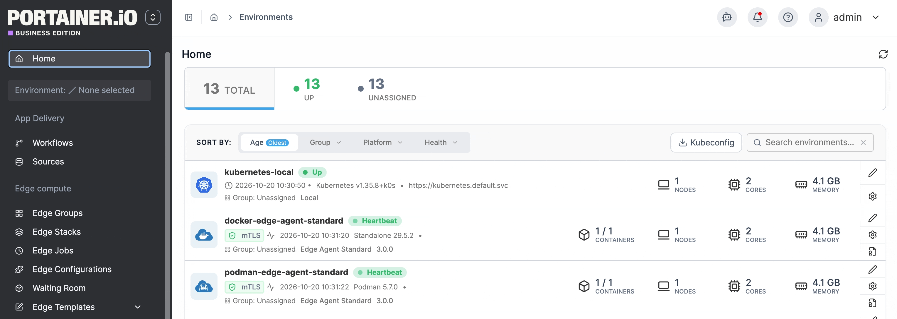
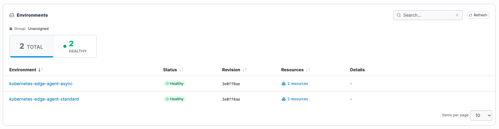
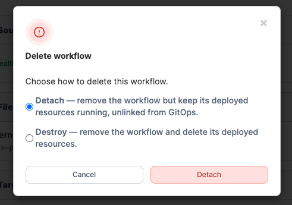

# Manage a workflow

The workflow detail page gives you a live view of a workflow's health, the git sources and files it draws from, the stacks it manages, and the environments those stacks are deployed to.

To manage a GitOps workflow, in the left-hand menu select **Workflows**, then click into the workflow you would like to manage.

### Edit a workflow

To edit a workflow, from the workflow details view, select **Edit**. This returns you to the [workflow creation steps](add-a-new-workflow.md) with your preconfigured values, allowing changes to any field.

<figure><figcaption></figcaption></figure>

To configure settings of your created stack, from the workflow details view, click the stack name to be taken to the [Edit Edge stack](../../edge/stacks/) view.

### Reconciliation engine status view

Workflows using the [reconciliation engine](add-a-new-workflow.md#reconciliation-engine) replace the Stacks card with an **Environments** table that reports what each environment applied and whether it matches the source.

#### Status summary bar

A status bar above the table shows the count of environments in each state:

| Status      | Meaning                                                                                                         |
| ----------- | --------------------------------------------------------------------------------------------------------------- |
| **Error**   | The environment failed to apply the deployment.                                                                 |
| **Drifted** | The environment applied the deployment, but one or more resources have since been changed outside of Portainer. |
| **Syncing** | The environment is currently applying the deployment.                                                           |
| **Healthy** | The environment's resources match what the source declares.                                                     |
| **Unknown** | The environment has not yet reported back, or its status cannot be determined.                                  |

Click any segment to filter the table to environments in that state. Click the same segment again to clear the filter.

#### Environment table

The table lists one row per environment per artifact. When a workflow has more than one artifact, an **Artifact** column appears to identify which deployment each row belongs to.

| Column          | Description                                                                                                                               |
| --------------- | ----------------------------------------------------------------------------------------------------------------------------------------- |
| **Environment** | The environment name. Click to open the environment dashboard.                                                                            |
| **Status**      | The current reconciliation status. A **Unreachable** badge appears alongside the status when the environment has not checked in recently. |
| **Revision**    | The short Git commit hash of the source revision this environment last applied.                                                           |
| **Resources**   | The number of Kubernetes resources the deployment declares. Click to open the deployment resources list.                                  |
| **Drift**       | The number of resources that have drifted from the source. Click to see exactly which fields changed and in which direction.              |
| **Actions**     | Per-environment actions, including opening the Helm release details for chart-based deployments.                                          |

**Drift details**

Click the drift count for any row to open a modal showing which resources drifted and what changed. Each drifted resource shows the fields that differ, with the source-declared value and the current cluster value. Secrets are masked before the report is built and are safe to display.

Drift entries can show one of the following operation types:

| Operation   | Meaning                                                                          |
| ----------- | -------------------------------------------------------------------------------- |
| `add`       | The field is in the source but not set on the cluster.                           |
| `remove`    | The field is set on the cluster but no longer declared in the source.            |
| `replace`   | The field differs — source value → cluster value.                                |
| `unmanaged` | The field is on the cluster but owned by another manager; re-applying leaves it. |
| `missing`   | The entire resource is in the source but not on the cluster.                     |

**Reconcile now**

The **Reconcile** button, available on the workflow detail header and on each environment row, asks the workflow to apply immediately rather than waiting for the next reconcile interval. Use this to push a source change without waiting, or to manually correct drift when drift detection is set to **Report drift** rather than **Reconcile drift**.


Reconcile now triggers a re-apply on all environments at their next check-in. It does not wait for confirmation that the apply completed - use the **Refresh** button on the Environments table to re-read what each environment has reported after a reconcile.


<figure><figcaption></figcaption></figure>

### Migrate to the reconciliation engine

A workflow that was created with the Edge stack engine can be migrated to the reconciliation engine by editing it and switching the engine selector to **Reconciliation**.


Migration is one-way and cannot be undone. Once saved on the reconciliation engine, the workflow cannot be switched back to Edge stacks.


When you save a workflow that has been switched to Reconciliation:

* The workflow's Edge stacks are removed from Portainer.
* What the Edge stacks deployed **keeps running** on the cluster - the reconciliation engine adopts the existing resources using the same field manager (`portainer`), so the first reconcile updates in place without deleting and recreating anything.
* Environments that were unreachable during the migration are still notified to drop the old Edge stack when they come back online.


Saving migrates this workflow to the reconciliation engine and removes its Edge stacks. What they deployed keeps running, and this cannot be undone.


### Delete a workflow

To delete a workflow, from the workflow details view, click **Delete.** You will then be asked to choose what happens to the stacks and resources it has already deployed. Choose between the following:

**Detach (default):**\
Removes the workflow record from Portainer but leaves all deployed stacks and resources running exactly as they are, no longer linked to any GitOps workflow. Choose this when you want to take manual control of the resources without interrupting live workloads.


Workflows using the reconciliation engine cannot be detached — only destroyed. Because the reconciliation engine manages resources directly rather than through named Edge stacks, there is no intermediate state to hand off to.


**Destroy:**\
Removes the workflow and deletes all resources it has deployed across every artifact and target environment. This cannot be undone. Choose this only when you want the deployed workloads permanently removed.

To confirm your selection, select **Detach** or **Destroy**.

<figure><figcaption></figcaption></figure>
