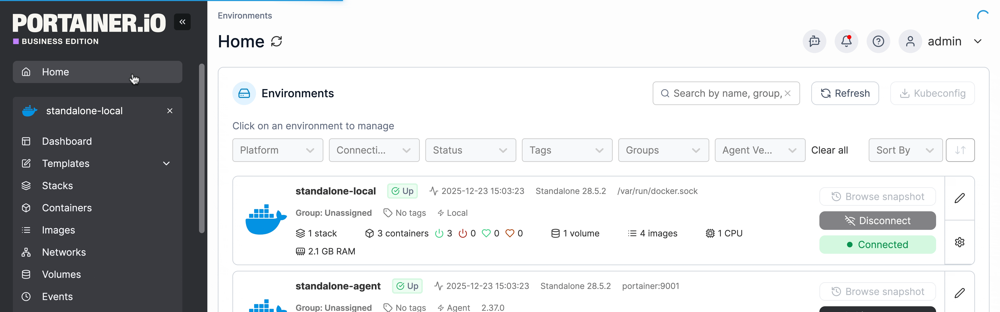
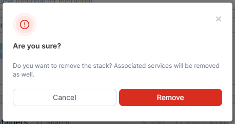

# Remove a stack


A stack deployed by a GitOps workflow can't be removed this way - its row checkbox is disabled. Detach it from Git on its own detail page, or delete the workflow, instead.


From the menu select **Stacks**, tick the checkbox next to the stack you want to remove, then click **Remove**.

<figure><figcaption></figcaption></figure>

When the confirmation message appears, click **Remove**.

<figure><figcaption></figcaption></figure>
