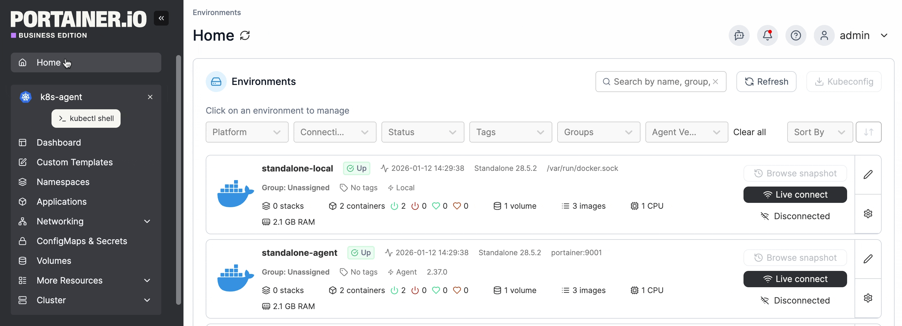
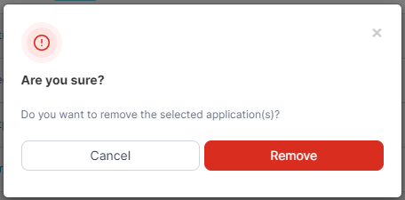

# Remove an application


An application deployed by a [GitOps workflow](../../app-delivery/workflows/) can't be removed this way - its row checkbox is disabled. Detach it from Git on its own detail page, or delete the workflow, instead.


From the menu select **Applications**, tick the checkbox next to the application you want to remove then click **Remove**.

<figure><figcaption></figcaption></figure>

When the confirmation message appears, click **Remove**.

<figure><figcaption></figcaption></figure>
