# Manage a namespace

From the menu select **Namespaces** then select the namespace you want to manage.

<figure>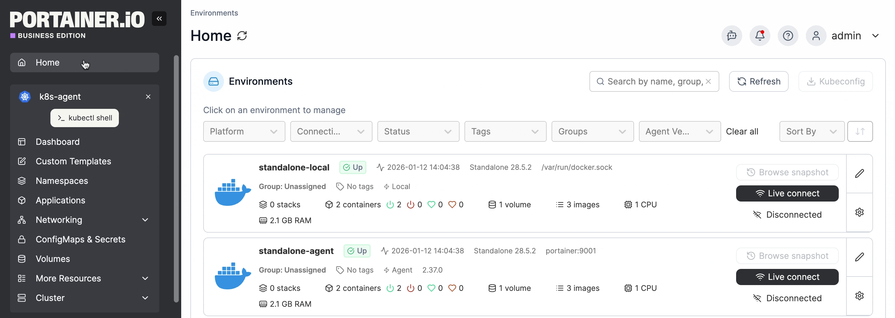<figcaption></figcaption></figure>

The namespace details view is organized into tabs: **Namespace**, **Events**, **Resource Quotas**, and **YAML** - plus **Metrics** and **Logs** when observability is configured for the environment. Below the selected tab (except on the **Metrics** and **Logs** tabs), a table lists the applications running in this namespace.

### Namespace tab

Here you can view details about the namespace and configure options specific to it.

The namespace **Name** is shown but cannot be changed. You can add or edit annotations for the namespace as required.

#### Resource Quota

Toggle on **Resource assignment** to enable quotas for this namespace, then define the memory and CPU limits. The current resource reservation and usage for the namespace will be displayed when a limit is set.


The limit you set here must fit within what the cluster actually has available. This check now takes into account every resource quota in the cluster, including quotas that were not created by Portainer, such as pre-existing ones on namespaces onboarded from another tool. This only applies when the cluster's resource over-commit option is off.


<figure>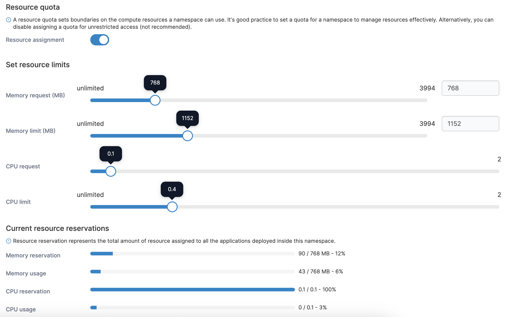<figcaption></figcaption></figure>

#### Load balancers


This option only appears when **Allow users to use external load balancer** is enabled in the cluster setup.


With this setting you can configure the amount of external load balancers that can be created in this namespace.

<figure>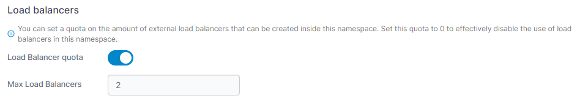<figcaption></figcaption></figure>

#### Networking


This section is only visible when **Configure ingress controller availability per namespace** is enabled in the Cluster Setup.


This section lets you define which ingress controllers are allowed to be used to publish applications within this namespace. Check the boxes next to the ingresses you want to allow and click **Allow selected**, or click **Disallow selected** to disallow their use in this namespace.

<figure>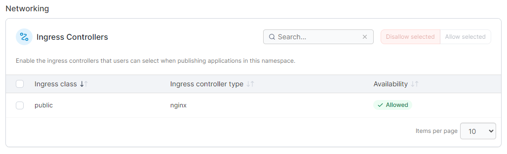<figcaption></figcaption></figure>

#### Storage

For each storage option available in the cluster, you can configure quotas for this namespace to limit usage.

<figure>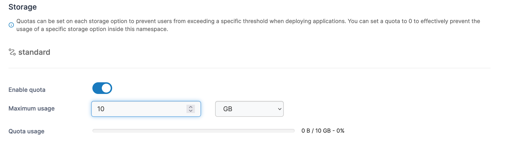<figcaption></figcaption></figure>

#### Registries

You can define the registries that are available within this namespace in this section. Select the registries from the **Select registries** dropdown to allow access.

<figure>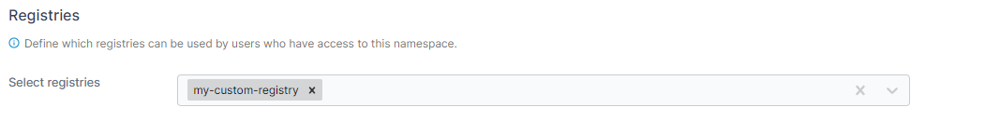<figcaption></figcaption></figure>

#### Summary

If you have made changes to the configuration, this section will list those changes.

<figure>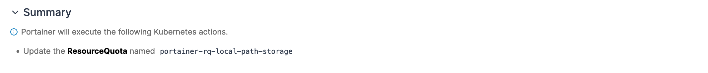<figcaption></figcaption></figure>

#### Actions

Once you have made the necessary changes, click **Update namespace**. Here you can also flag the namespace as a system namespace by clicking **Mark as system**.

<figure>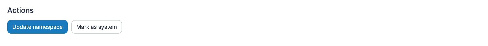<figcaption></figcaption></figure>

### Events tab

Shows information about events related to any resource in this namespace, not just the namespace object itself. If there are any active warning-level events, a count badge appears next to the **Events** tab label.

<figure>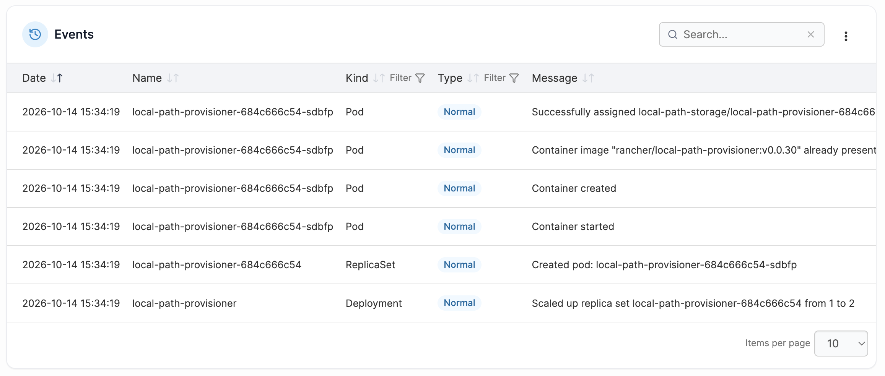<figcaption></figcaption></figure>

### Resource Quotas tab

This is different from the **Resource Quota** setting on the **Namespace** tab above, which only shows and edits the single quota that Portainer manages. The **Resource Quotas** tab lists every resource quota that exists in the namespace, including quotas created outside Portainer, for example on namespaces that already existed before being added to Portainer.

For each quota, the table shows its **Name** (click through for its full YAML), **Scope** (the pods or objects it applies to, or `All` if unscoped), **Used / hard** for each resource it limits, and when it was **Created**. Quotas not managed by Portainer are shown read-only.

Above the table, **Effective ceiling** dials show the limit actually binding each resource across the namespace. Kubernetes enforces every quota in a namespace at the same time, so when more than one quota constrains the same resource, the smallest hard value is the one that counts, hover a dial to see which quota it comes from.

<figure><figcaption></figcaption></figure>

### YAML tab

Shows the YAML for the namespace itself and for every resource quota it contains, not just the one managed by Portainer. To apply any changes you make within the YAML editor, select the **Apply changes** button, and select **Apply changes** if you are sure. Changes are made by calling the Kubernetes API to patch the relevant resources. Any resource removals or unexpected resource additions that you make in the YAML will be ignored. Note that editing is disabled for resources in namespaces marked as system.

<figure>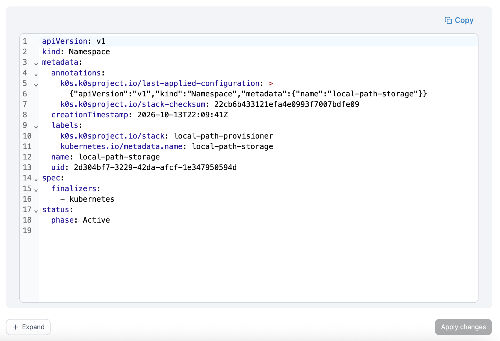<figcaption></figcaption></figure>

### Metrics tab

Available when an [observability policy](../../../admin/environments/policies/kubernetes-policies/create-a-kubernetes-observability-policy.md) is configured for the environment's group. Shows heartbeat, CPU, memory, network, and file system usage charts for the namespace over a selectable time range, with a link to open the same data in OneUptime.

### Logs tab

Available when an [observability policy](../../../admin/environments/policies/kubernetes-policies/create-a-kubernetes-observability-policy.md) is configured for the environment's group. Shows a searchable log viewer covering all pods in the namespace. Filter by severity or search text and adjust the time range, or open the same logs in OneUptime.

### Applications running in this namespace

Below the selected tab (except on the **Metrics** and **Logs** tabs), a table lists the applications running in this namespace - Deployments, DaemonSets, StatefulSets, and standalone Pods.

<figure>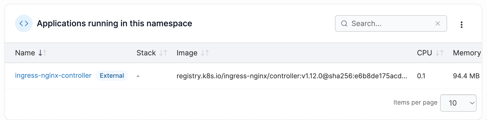<figcaption></figcaption></figure>
