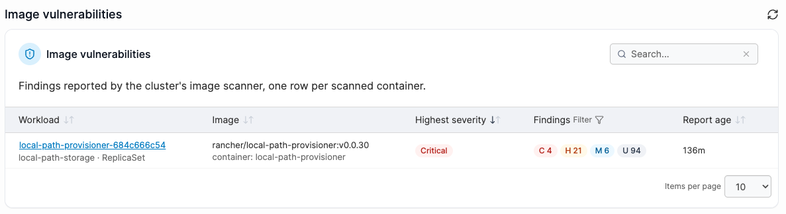
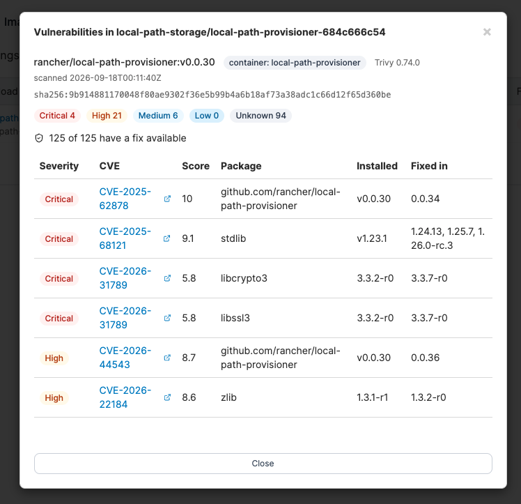
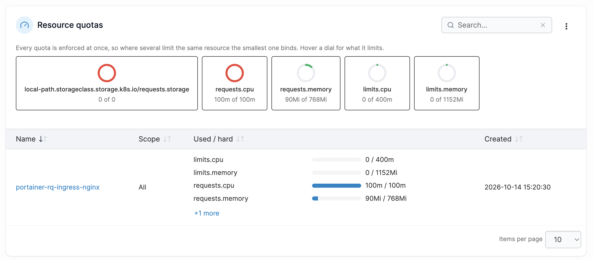
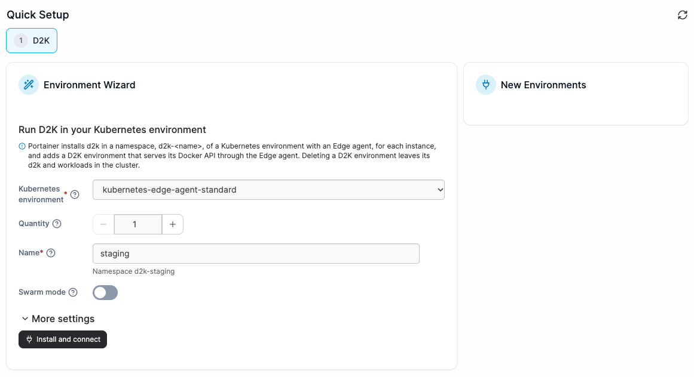
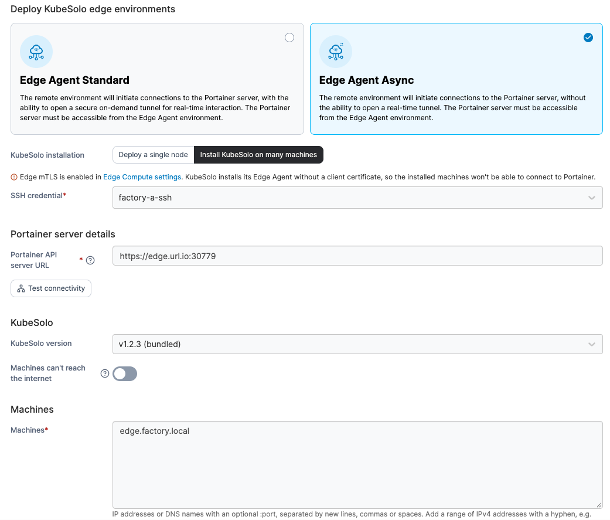

# What's new in version 3.0

Portainer version 3.0 includes a number of new features, fixes and updates. For a full list of changes, please refer to our [release notes](https://app.gitbook.com/o/-MgDK9ndL1-o2MHHFiXo/s/6IKMiLNKQEbVchxatvbm/release-notes).

### Short Term Support (STS) 

3.0 is a Short Term Support, or "STS", release of Portainer. STS releases intended to be an introduction of new features and functionality in Portainer, and while we do perform significant testing prior to release are not recommended for production use. For production, we recommend staying with the Long Term Support (LTS) releases. The features that appear in STS releases will, once refined and stable, be implemented in the next LTS release.You can read more about our release principles in our [lifecycle policy](https://docs.portainer.io/sts/start/lifecycle).

## New in this release 

### A new major version

Portainer 3.0 marks our move to a Kubernetes-first codebase, that brings a new family of purpose-built consoles designed around how teams actually work.\
If you're running Docker today, don't panic - nothing changes on 2.x, and we lay out exactly what your options are going forward  ([D2K](https://github.com/portainer/d2k), [KubeSolo](https://kubesolo.io/), migrating to native Kubernetes, or just staying put).\
Full details can be found in [this blog post](https://portainer.io/blog/portainer-3-0-is-coming).

### Vulnerability scanning

Attach a [vulnerability scanning policy](admin/environments/policies/kubernetes-policies/create-a-kubernetes-vulnerability-scanning-policy.md) to a Kubernetes environment group and Portainer deploys and configures trivy-operator to scan running workloads on a schedule you control. Review findings - severity, CVEs, and available fixes - in the new [Image Vulnerabilities](user/kubernetes/more-resources/image-vulnerabilities.md) view, and pair it with an [alert rule](user/alerting/) to get notified when critical or high severity issues turn up.

<figure><figcaption></figcaption></figure>

<figure><figcaption></figcaption></figure>

### Unified namespace resource quotas

The new [Resource Quotas tab on the namespace details view](user/kubernetes/namespaces/manage.md#resource-quotas-tab) lists every resource quota in a namespace, not just the one Portainer manages - including quotas that already existed on namespaces onboarded from another tool. Effective ceiling dials show the limit actually binding each resource across the namespace, so when more than one quota constrains the same CPU or memory value, it's clear at a glance which one is in control.

Resource quota limits are now also checked against the cluster's real available capacity when you create or update a namespace, accounting for every quota in the cluster - so the limit you set is always one the cluster can actually honour.

<figure><figcaption></figcaption></figure>

### A reconciliation engine for GitOps workflows

GitOps workflows can now target Kubernetes environments with a new [Reconciliation engine](user/app-delivery/workflows/add-a-new-workflow.md#choose-an-engine) (Beta), alongside the existing Edge stack engine. Rather than deploying as an Edge stack, it keeps Edge Kubernetes environments continuously matching their source, and either reports or automatically corrects anything that drifts.

A workflow can also now deploy more than one stack at once. Add an artifact for each one, pulling from multiple sources if needed, and set dependencies between them to control deploy order.

<figure><figcaption></figcaption></figure>

### Automatic namespace provisioning policy

Attach an [automatic namespace provisioning policy](admin/environments/policies/kubernetes-policies/create-a-kubernetes-automatic-namespace-provisioning-policy.md) to a Kubernetes environment group and Portainer gives every eligible user their own namespace and a namespace-scoped role inside it, generated from a pattern you define - no more creating namespaces and granting access by hand as users join, change their authentication method, or leave.

<figure><figcaption></figcaption></figure>

### Add a D2K environment

Add a [D2K environment](admin/environments/add/add-a-d2k-environment.md) to run Docker workloads - containers, stacks, volumes, and networks - on a Kubernetes cluster, without installing a second agent or giving up Kubernetes as the underlying platform. D2K serves the Docker API from a namespace of an existing Kubernetes environment with an Edge agent, so standard Docker RBAC and the familiar Docker views apply to it like any other Docker environment.

<figure><figcaption></figcaption></figure>

### Install and manage KubeSolo at scale

The KubeSolo (Edge) wizard can now [install KubeSolo on many machines at once over SSH](admin/environments/add/add-a-kubesolo-edge-environment/install-edge-agent-async-on-kubesolo.md#install-kubesolo-on-many-machines), instead of running `kubesoloctl` by hand on each one. Portainer tests every machine first - connectivity, sudo access, architecture, and more - groups any failures by cause with a suggested fix, then installs KubeSolo only on the machines that passed, each becoming its own environment automatically. Air-gapped machines are supported with an uploaded offline install bundle.

Every KubeSolo environment also gets a [new KubeSolo page](user/kubernetes/cluster/kubesolo.md) showing its running version and configuration, and removing a KubeSolo environment now offers the option to uninstall it from the machine at the same time.

<figure><figcaption></figcaption></figure>
