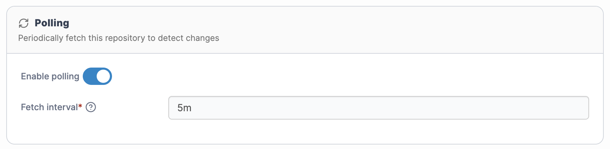
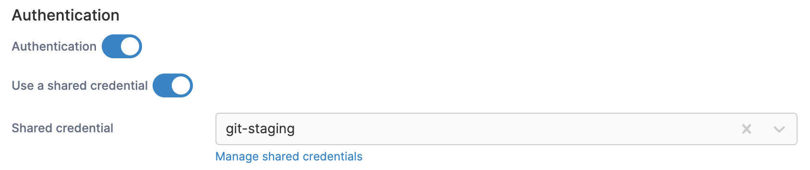
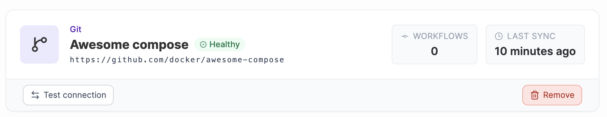

# Troubleshooting GitOps sources and workflows

From Portainer 2.44 STS, GitOps was reworked around [Sources](../../../user/app-delivery/sources/) and [Workflows](../../../user/app-delivery/workflows/). A source holds the connection to a Git repository, including its credentials and change detection settings, and each workflow deploys from a source. This page covers the most common issues reported since the change, and how to resolve them.

### Where did the stack polling settings and webhook controls go?

Polling is now configured on the Git source rather than on each stack. Deployments that use a source inherit its polling behavior. Webhooks are also consolidated into one per source, and calling it triggers a check for changes across all deployments that use that source.

To change polling, go to **App Delivery** > **Sources**, select the source, then select **Edit**. You can enable or disable polling and set the fetch interval from the **Settings** tab.

<figure><figcaption></figcaption></figure>


Because polling is set on the source, any change you make applies to every workflow that uses that source.


Turning off polling stops Portainer from periodically fetching the repository. It doesn't necessarily stop every other way a deployment can be triggered, such as the source's webhook.

***

### How can I auto-update DEV but keep PROD manual if they share a repository?

Because polling is a setting of the source, workflows that share a source also share its polling behavior. You can't currently disable automatic updates for one workflow while keeping them enabled for another on the same source.

You can work around this in two ways:

* **Use a separate source for production.** Add the repository as a second source with polling disabled, and point your production workflow at it. Portainer identifies a source by its repository URL together with its authentication details, so the second source needs to use different credentials to the first (for example, a separate access token).
* **Track a protected branch or tag in production.** Have your production workflow use a branch or tag that only changes through a controlled review, merge or promotion step. This gates which changes reach production, but doesn't switch off automatic updates for that workflow.

Whichever approach you use, test it with a non-critical workflow first to confirm production only changes when you expect it to.

***

### Why can't I delete a source that shows zero workflows, and why are deleted stacks still being polled?

You may see an error saying the source is used by workflows or custom templates, even though its **Workflows** tab is empty. You may also see the scheduler logs repeatedly reference stacks that no longer exist.

This happens when leftover workflow records still reference stacks that were deleted. These records aren't shown in the interface, but the check that runs when you delete a source, and the scheduler, still find them.

This will resolve after upgrading from 2.44.0 STS to 2.45.0 LTS. Upgrade to the latest release for your Portainer version, then try deleting the source again. If the problem persists after upgrading, [contact Support](https://www.portainer.io/resources/get-support) with the details.

***

### Why does the Sources page fail with "Object not found ... bucket=workflows"?

The **Sources** page, or the source selection when you deploy, fails to load with an error naming a missing record in the `workflows` bucket.

This happens when a stack references a workflow record that no longer exists. Instead of ignoring the missing reference, the page fails to load, which can affect the whole Sources page. This was reported after upgrading from 2.39 LTS to 2.45.0 LTS, and source visibility and application creation were restored after upgrading to 2.45.2 LTS.

If you see this error, upgrade to the latest release for your Portainer version. If it persists, [contact Support](https://www.portainer.io/resources/get-support) and include your exact Portainer version and the full error text.


Log messages that mention `meta.json` from Prometheus are unrelated to this error.


***

### Do I need a separate access token for every GitOps source?

No. Shared Git credentials were restored in 2.44.0 STS, so you can create a credential once and reuse it across multiple sources. A source and a credential are separate things: the source is the repository connection, and the credential is how Portainer authenticates to it.

When you [add a new Git source](../../../user/app-delivery/sources/add-a-new-git-repository-source.md), enable **Use a shared credential** and select an existing [credential](../../../admin/settings/credentials/) rather than entering a new token for each repository.

<figure><figcaption></figcaption></figure>

If you change or rotate a credential that is used by several sources, select the **Test Connection** option on each of those sources afterwards to confirm they can still reach their repositories.

<figure><figcaption></figcaption></figure>


Don't change the repository URL of an existing source to point at a different repository. Workflows that already use the source will be affected.

