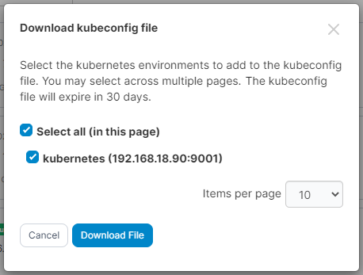

# Kubeconfig

Portainer can act as a proxy for other Kubernetes management tools, providing access to the Kubernetes cluster while still retaining the security and governance that Portainer provides. A user can download their own `kubeconfig` file and use it with their favorite tool to access the Kubernetes cluster with only the permissions afforded to that user.\
\
To generate and download your `kubeconfig` file, from the Home page click the **kubeconfig** button.


You must be accessing Portainer via HTTPS for the kubeconfig button to appear. If you are logged in with HTTP, you will not see the option.


<figure><figcaption></figcaption></figure>

You will be asked to select the Kubernetes environments that you would like in your `kubeconfig` file. If you have configured a [kubeconfig expiry](../../../admin/settings/general.md#kubeconfig) value, this will also be shown.

<figure><figcaption></figcaption></figure>

Tick the boxes for the environments you need and click **Download File**.

A downloaded `kubeconfig` file will look something like the example below.


Note that the server URL is set to the Portainer Server instance, not the Kubernetes cluster.


```yaml
apiVersion: v1
clusters:
- cluster:
    insecure-skip-tls-verify: true
    server: https://my-portainer-server:9443/api/endpoints/1/kubernetes
  name: portainer-cluster-kubernetes
contexts:
- context:
    cluster: portainer-cluster-kubernetes
    user: portainer-sa-clusteradmin
  name: portainer-ctx-kubernetes
current-context: portainer-ctx-kubernetes
kind: Config
preferences: {}
users:
- name: portainer-sa-clusteradmin
  user:
    token: xxxxxxxxxxxxxxxxxxxxxxxxxxxxxxxxxxxxxxxxxxxxxxxxxxxxxxxx
```

Each environment in the `kubeconfig` will be accessible via contexts. Access is set based on the specific user that created the `kubeconfig` file.

Each environment's context has its own token, generated separately for that environment. A token is only valid for proxying Kubernetes API requests to the environment it was issued for - it cannot be used to access any other environment in the kubeconfig, and it cannot be used to call the Portainer API directly.

Each user entry in the `kubeconfig` file is named after your Portainer service account, followed by the ID of the environment its token is issued for.

If a `kubeconfig` token is used to call the Portainer API, the request returns a `403` response with the message `Access denied` and the details `The token scope is not allowed on this route`. To use the Portainer API from a script or tool, create an access token instead.


A `kubeconfig` file downloaded from an earlier version of Portainer uses a single token for all of its environments. That token can no longer call the Portainer API, but it can still proxy requests to every environment you have access to until it expires. Download a new `kubeconfig` file to replace it with per-environment tokens.


Unless set to never expire, tokens will expire after the defined period, at which point a new `kubeconfig` file will need to be generated. An administrator can [adjust the token expiry behavior](../../../admin/settings/general.md#kubeconfig) on the **Settings** page.


Adjusting the token expiry will not affect previously generated `kubeconfig` files.

