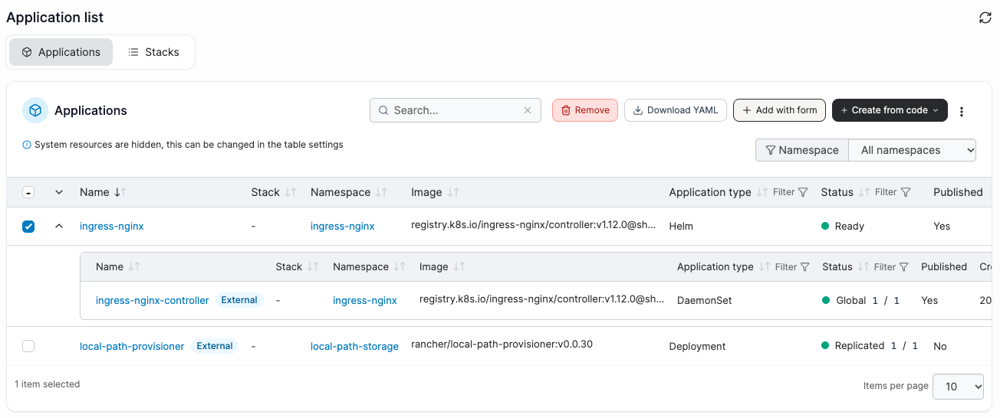

# Download application YAML


An application deployed by a GitOps workflow, one in a system namespace, or one in a namespace you don't have write access to, can't be downloaded this way - its row checkbox is disabled.


From the menu select **Applications**, tick the checkbox next to one or more applications, then select **Download YAML**.

<figure><figcaption></figcaption></figure>

Portainer downloads a single zip, `kubernetes-applications.zip`, with one folder per selected application. A folder contains a YAML file for the application's workload, and one for each Service or HorizontalPodAutoscaler associated with it; a Helm release's folder contains every workload the release deployed.

Cluster-assigned and runtime fields - status, UID, creation timestamp, resource version, owner references, node name, and similar - are stripped from each file, so the YAML can be re-applied as-is.

If an application's manifest can't be retrieved, it's skipped and the rest of the zip still downloads; a warning names which applications were skipped.
