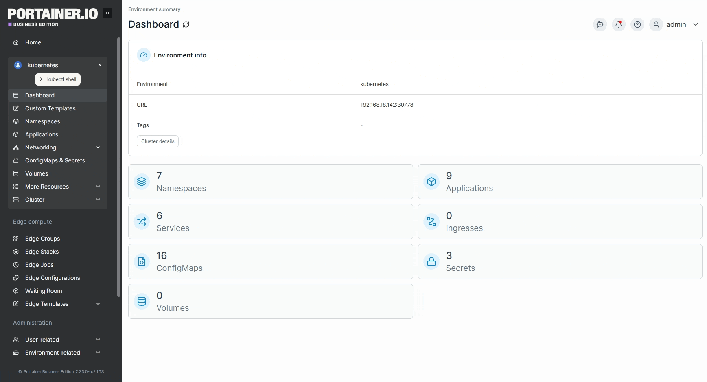

# kubectl shell

Although the Portainer UI provides access to a lot of Kubernetes functionality, sometimes you need to drop into the console. We have provided a shell within the UI that includes `kubectl`, `helm`, `bash` (with completion and the `k` / `ks` aliases), `jq`, and `wget`. The shell is preloaded with a `kubeconfig` for the user's context, restricting access to the permissions defined in Portainer for that user.

To access the shell, select **kubectl shell** from the menu. Once the shell loads, you can run `kubectl` and `helm` commands as needed.


As of versions 2.45.4 LTS / 3.1 STS, `curl` is no longer included in the kubectl shell, to reduce its exposure to CVEs. Use `wget` for simple HTTP(S) requests instead, for example `wget -qO- https://example.com`.


<figure><figcaption></figcaption></figure>
