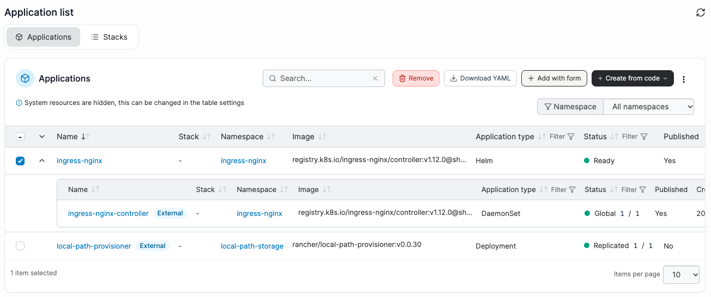

# What's new in version 3.1

Portainer version 3.1 includes a number of new features, fixes and updates. For a full list of changes, please refer to our [release notes](release-notes.md).

### Short Term Support (STS) 

3.1 is a Short Term Support, or "STS", release of Portainer. STS releases intended to be an introduction of new features and functionality in Portainer, and while we do perform significant testing prior to release are not recommended for production use. For production, we recommend staying with the Long Term Support (LTS) releases. The features that appear in STS releases will, once refined and stable, be implemented in the next LTS release.You can read more about our release principles in our [lifecycle policy](https://docs.portainer.io/sts/start/lifecycle).

## New in this release 

#### Pattern matching in GitOps workflow artifacts&#x20;

When [selecting files for a workflow artifact](user/app-delivery/workflows/add-a-new-workflow.md), you can now enter a wildcard expression instead of picking files one by one. The expression is kept as a live rule and re-matched against the source on every sync, so files later added to or removed from the matched location are picked up automatically, without editing the workflow. Dragging a file onto **Add artifact** now also creates a new artifact pre-populated with that file, instead of requiring you to add one first.

#### Download application YAML

You can now select one or more Kubernetes applications from the list view and [download their manifests ](user/kubernetes/applications/download-application-yaml.md)as a single zip, with one folder per application covering its workload, Services, and HorizontalPodAutoscaler. Cluster-assigned fields are stripped automatically, so the YAML is ready to re-apply or check into Git.

<figure><figcaption></figcaption></figure>

#### Kubernetes Pod Security support for D2K&#x20;

[D2K environments](admin/environments/add/add-a-d2k-environment.md) now surface the Kubernetes Pod Security level enforced on their namespace directly in the Docker container and stack creation forms, so you find out what's refused before submitting instead of after. On a "restricted" namespace, creating a container now turns on **Drop all capabilities** and the `no-new-privileges` security option automatically, and requires a numeric non-root user before the form can be submitted.

